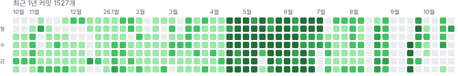

<p align="center">
  
</p>

<h1 align="center">Hi ?! I'm Here !;</h1>
<p align="center">Backend &amp; Full-stack Developer</p>

> [!IMPORTANT]
> **아래 통계 카드와 GitHub 공식 기여 데이터는 orphan 브랜치 작업을 반영하지 않습니다**.  
> **이로 인한 소통의 오류를 방지하고 싶어 오펀 브랜치를 반영한 기여 그래프를 별도로 렌더링합니다**.

<p align="center">
  
</p>

<p align="center">
  
</p>

<p align="center">
  
  
</p>

## 오펀 브랜치를 포함하는 잔디 그래프

<p align="center">
  
</p>

공식 기여 그래프와 달리, 소유한 공개 저장소의 **모든 브랜치**에서 제 이름으로 된 커밋을 모아 날짜별로 집계한 최근 1년 그래프입니다.

ci 워크플로우가 매일 자동으로 갱신합니다.

## 지금 만들고 있는 것

| 프로젝트 | 설명 | 스택 |
| --- | --- | --- |
| [node-order](https://github.com/seungwoo7050/node-order) | 여러 단계에 걸쳐 확장중인 주문 서비스 프로젝트<br>[서비스 링크](https://shop.43-202-205-93.sslip.io/shop) / [저장소 링크](https://github.com/seungwoo7050/node-order) | Node.js · TypeScript · NestJS · Next.js · Prisma · PostgreSQL · Redis |
| [typography-playground](https://github.com/seungwoo7050/typography-playground) | opentype.js와 WebGL2로 만든 키네틱 타이포그래피 엔진<br>[서비스 링크](https://typography-playground.seungwoo7050.workers.dev/) / [저장소 링크](https://github.com/seungwoo7050/typography-playground)| Next.js 16 · WebGL2 · opentype.js · Web Worker |
| [horang](https://github.com/seungwoo7050/horang) | 인천공항 → 공항철도 → 서울역, 막히는 지점마다 단계별로 안내하는 여행 도우미<br>[서비스 링크](https://horang.seungwoo7050.workers.dev) / [저장소 링크](https://github.com/seungwoo7050/horang) | Next.js 16 · React 19 · TypeScript · Cloudflare Workers |
| [hamkke](https://github.com/seungwoo7050/hamkke) | 장거리 연애 커플을 위한 2인 전용 프라이빗 앱 (웹 · Android)<br>배포 준비중 / [저장소 링크](https://github.com/seungwoo7050/hamkke)| Next.js 16 · tRPC · Prisma · Postgres · Capacitor · Stripe |

각 저장소 README에 최신 커밋 수·테스트 수가 적혀 있습니다. 여기서는 중복 기재하지 않습니다.

## 깃허브 저장소 관리 방식: 브랜치 하나 = 독립된 환경 하나

42 과정 과제, 자가 학습, 사이드 프로젝트는 모두 **주제별 orphan 브랜치**로 관리합니다. 브랜치마다 공통 조상이 없어 의존성과 실행 환경이 서로 섞이지 않고, 각 브랜치는 독립적으로 클론·실행·검증할 수 있습니다. `main`에는 브랜치 목록을 정리한 인덱스 문서만 둡니다. **머지되지 않은 채 방치된 브랜치가 아니라, 저장소를 매번 새로 만드는 대신 하나의 저장소 안에서 주제별로 독립된 환경처럼 쓰기 위한 선택**입니다.

이 구조의 대가는 GitHub 기여 그래프입니다. **GitHub는 기본 브랜치(그리고 머지된 PR) 커밋만 기여로 집계하므로, 아래 작업의 대부분은 그래프에 나타나지 않습니다**. 대신 각 브랜치의 커밋 기록 자체가 날짜가 찍힌 작업 로그입니다.

## 작업 타임라인 (2025.01 - )

| 저장소 | 구성 브랜치 개수 | 내용 |
| --- | :---: | --- |
| [42c-workspace](https://github.com/seungwoo7050/42c-workspace) | 7 | 42 Seoul C 과제 재구현 - libft, get_next_line, ft_printf, push_swap, minitalk, philo, minishell |
| [42cpp-workspace](https://github.com/seungwoo7050/42cpp-workspace) | 3 | 42 Seoul C++ 과제 재구현 - C++98 정적 라이브러리, ray tracer(miniRT), IRC 서버(ft_irc) |
| [node-workspace](https://github.com/seungwoo7050/node-workspace) | 10 | 같은 주문 관리 도메인을 JS → TS → Express/NestJS → React/Next.js → WebSocket까지 단계별로 재구현 |
| [42web-workspace](https://github.com/seungwoo7050/42web-workspace) | 3 | Docker/K8s 컨테이너 스택, 42 웹 과제 재구현(ft_transcendence), 포트폴리오 템플릿 |

```sh
git clone https://github.com/seungwoo7050/<repo>.git
cd <repo> && git switch <branch>   # 또는 git worktree add ../<branch> <branch>
```
